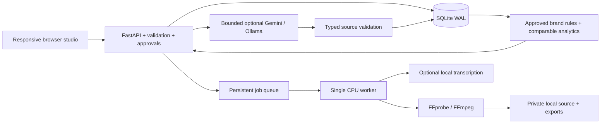

# REMIXORA AI

A local editing studio for recordings, clips and publishing drafts.

A locally deployed, single-creator media repurposing studio. Paste a permitted YouTube link or upload original media, transcribe locally, discover explainable moments, create platform drafts and actual branded MP4s, learn approved style rules from edits, plan posts, and use imported outcomes to adjust future recommendations.

## Open the app

The local instance runs at **http://127.0.0.1:8000**. To start it again on this Windows machine:

```powershell
.\run-local.ps1 -Background
```

For password-protected local access use `-Authenticate` after stopping the existing process. It creates gitignored `.local-auth.json` with the local sign-in credentials. The default development instance is loopback-only; it is not a public service. Full setup, Docker, providers and backup instructions: [DEPLOYMENT.md](DEPLOYMENT.md).

## What works

| Workflow | Implemented behavior |
|---|---|
| Saved automatic workflows | YouTube watch/live/Shorts/youtu.be ingestion, manual or automatic YouTube captions, local speech fallback, Shorts/informative objectives, 1–5 requested clips, approximate 30/45/60-second targets, automatic drafts and MP4s, durable progress and resume |
| Ingest | Stream-to-disk limits, binary/container/codec/audio checks, 150 MB and 30 minute defaults, checksum deduplication, SRT/VTT alignment and manual transcript repair before discovery |
| Clip Scout | Exact segment evidence, 15–60 second windows, overlap removal, labeled heuristic or validated optional-model provenance, rubric/base/adjusted scores |
| Remix Lab | Three angles × three platforms, editable copy, copy/TXT export, revision rollback, approval, original cut exports and distinct 720×1280 MP4 variants with headlines and optional burned-in captions |
| Brand DNA | Persistent creator profile, edit history/diff, specific pending style proposals, explicit approval/deactivation, memory revision and rules shown on new drafts |
| Content Calendar | Approval-gated entries, timezone validation including DST ambiguity, slot conflicts, month/week/list views, platform filtering, rescheduling/canceling and manually-published status |
| Feedback Lab | Validated CSV import, distinct-clip sample counts, immutable/deduplicated measurements, comparable groups, smoothing, performance revision and visible numeric adjustment on future clips |
| Settings | Tool/configuration/storage status, durable single media worker, bounded retries, interrupted-job recovery, metadata event trail and studio JSON export |

Local offline operation uses **heuristics and templates**, not a claim of autonomous model reasoning. Optional Gemini/Ollama can reason over bounded transcript evidence for scouting and copywriting. Six named workflow roles have typed contracts, deterministic tools and persisted outcomes. Human approvals cannot be bypassed by a model.

## Your creative workflow

1. Open **Import**. Paste a permitted YouTube URL (including `/live/` links) or upload a recording. Wait for import and transcription, then open **Smart Cuts**.
2. Choose one of 12 presets. Set duration, count, selection intensity, context padding, frame, captions and AI assistance. Analysis runs through the persistent queue. Source language is a capability setting, not translation. English is required for the specialized local speech cues; other languages support broad highlight/shorts selection and utility presets.
3. Review the source, evidence and score breakdown. Select candidates, reject/restore them or save a revised range. Choose **Render selected**, preview the export and download it. Open **Write captions** to create platform drafts in Remix. Saved analyses keep their own settings and history. Sources may produce fewer clips than requested, including no matches.
4. Review the specific rules inferred from edits in Brand DNA. Approve only those that represent your preferences. Generate drafts for a different clip to see the change; historical drafts stay unchanged.
5. Approve the current copy, then schedule it. **This does not post to any external platform.**
6. Import actual post metrics using the CSV template. At least three distinct clips per comparable angle group are required. Actual Instagram lifetime groups currently inform scouting. Other platform/period groups are displayed separately. Synthetic data never changes actual recommendations.

The bundled five-minute source is an original scripted **synthetic-narration demonstration**, visibly labeled. It is not a customer recording or an actual campaign. No sample analytics are presented as real. See [DEMO_WALKTHROUGH.md](DEMO_WALKTHROUGH.md).

## Smart Preset Engine

The default interface is a warm cream/sage glass studio with an editorial heading style, violet actions, restrained translucency, responsive layouts and reduced-motion support. Library, Smart Cuts, Import, Remix, Brand, Calendar, Results and Settings are the working views. Provider/setup details live in Settings.

| Preset | Evidence used |
|---|---|
| Funny Moments | Joke/setup and punchline transcript cues; measured audio energy |
| Reactions | Explicit spoken surprise plus measured delivery-energy change |
| Fail Moments | Explicit mistake and outcome cues |
| Clutch Moments | Tension followed by a stated successful turnaround |
| Funny Clips | Conversational banter and humor cues |
| Best Highlights | Non-overlapping selections distributed across the recording |
| Best Talking Moments | Speech continuity, complete story/opinion cues and clarity |
| Motivation | Encouragement, resolve and perseverance cues |
| Key Takeaways | Definitions, lessons and practical explanation cues |
| Shorts / Reels | Opening hook, clarity and self-contained source context |
| Cinematic | Actual frames sampled every five seconds: exposure, edge detail and frame change |
| Remove Silence | FFmpeg silence detection, retained-range edit list and real concatenated output |

Gemini/Ollama rank a bounded shortlist of eligible transcript windows. Valid AI selections take precedence over unreviewed local scores. Models cannot invent timestamps or bypass preset evidence requirements. Unavailable/invalid AI responses fall back to labeled local analysis. Approved brand rules guide semantic selection and existing copy generation. At least three distinct actual clips in the same preset/platform/lifetime group can supply a small, capped score adjustment for future analyses; old results remain unchanged.

Exports support 9:16 (720×1280), 1:1 (720×720) and 16:9 (1280×720), with optional transcript captions. Remove Silence produces a genuinely shorter MP4 or M4A, not just a list of quiet timestamps. Cinematic requires video. These measurements are not face tracking, laughter recognition, game-state understanding or a promise of viral performance. Specialized speech cues are estimates and require human review.

Preset modules: `app/presets.py`, `app/preset_signals.py`, `app/static/smart.js`; product views and design: `app/static/product.js`, `app/static/glass.css`. Additive database version 4 preserves existing media, clips, approvals and metrics. Bounds edits create a new clip revision. No user data is automatically deleted.

## Architecture



`app/main.py` owns API/approval contracts; `app/jobs.py` owns durable work; `app/media.py` owns media tools; `app/ai.py` owns provider routing and labeled fallbacks; `app/agents` holds Pydantic contracts; `app/db.py` owns additive migrations; `app/static` is the original responsive interface. All browser requests use same-origin paths.

## Validation

```powershell
python -m compileall -q app scripts
python -m pytest -q
node --check app/static/app.js
node --check app/static/workflow.js
node --check app/static/smart.js
node --check app/static/product.js
```

The test suite uses isolated temporary storage and actual FFmpeg media, checks exports by decoding them, verifies brand-memory effects on a different clip, calendar approvals/conflicts, feedback effects on two future sources, restart recovery, backup/restore, invalid input, storage limits, authentication, cross-origin protection and provider fallback. See [TEST_REPORT.md](TEST_REPORT.md) for measured results.

## Honest limits

- **No cloud deployment was requested or performed after the local-only choice.** Docker packaging is provided, but the installed Docker Linux engine was unavailable. Docker, Caddy HTTPS and ARM64 runtime remain unverified.
- **API keys:** YouTube import, local Whisper transcription and FFmpeg exports need no key. The installed tiny CPU speech model was exercised on an original narration fixture. For model-based editorial decisions and writing, configure Gemini (server-side key + model) or Ollama (installed local model, no key) in `.env.local`, preserving existing speech settings, then restart. Gemini is configured in this local workspace and has passed a live request; no additional key is needed for the current setup. Provider availability and quota can still vary.
- YouTube downloads depend on public accessibility and service restrictions. Private, restricted or unavailable videos may require uploading your original file. The importer does not use browser cookies or bypass access controls. Automatic captions and the small local speech model need human accuracy review.
- Offline templates are English and intentionally conservative. Audience, tone, formality, language and preferred-vocabulary profile fields guide configured models. Deterministic controls apply sentence length, hashtags, emoji removal, CTA, banned phrases outside quoted evidence, and supported approved memory rules. Arbitrary prose rules need a model; they are not silently interpreted as code.
- Model validation checks structure, segment ranges, quoted passages and unsupported numeric claims; it cannot prove every natural-language paraphrase correct. All generated copy remains review-gated.
- Calendar scheduling is local planning only. No social network connectors are enabled. Sample data is never a claim of actual engagement or performance lift.
- This is a single-user local demo architecture, not a hardened multi-tenant SaaS. There is no GDPR deletion UI or automatic retention policy. Studio export and backup/restore are provided.
- Historical transcript evidence freezes after clip discovery. Import repairs before discovery; old clips and feedback remain immutable for traceability.
- Benchmarks use a static-title-card demo on this Windows computer. They do not represent complex moving footage, mobile hardware, cloud CPUs or ARM64 performance.

## Provenance and licensing

The supplied starter was retained and extended independently. No OpenShorts source or third-party UI was copied. Dependencies retain their own licenses. The locally downloaded Windows FFmpeg distribution includes its original license/readme files in `.tools/ffmpeg`; it is excluded from Git and Docker context. See [INSPIRATION_AND_LICENSES.md](INSPIRATION_AND_LICENSES.md).

Planning and baseline: [IMPLEMENTATION_PLAN.md](IMPLEMENTATION_PLAN.md), [BASELINE_AUDIT.md](BASELINE_AUDIT.md). Coding conventions: [AGENTS.md](AGENTS.md).
